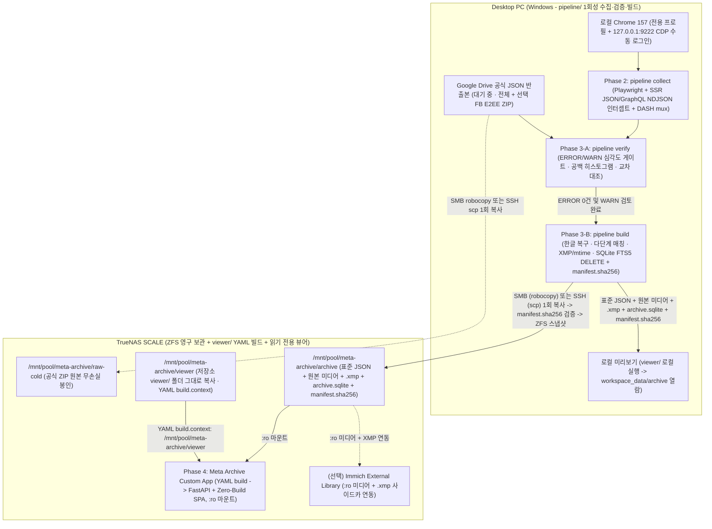

# Meta Archive — 전체 설계 및 구현 계획서

## Goal Description

Instagram 및 Facebook 계정을 영구 삭제하기 전에, Google Drive로 신청해 둔 **메타 공식 JSON 반출본("전체")**의 구조적 누락(타인 댓글·대댓글·댓글 좋아요·좋아요 수/명단·표시 이름·프로필 사진 등)을 **데스크탑 로컬 Chrome(CDP) + Playwright 수집기(`pipeline/`)**로 보강하고, 심각도 기반 무결성 검증·다단계 매칭 병합을 거쳐 **TrueNAS SCALE ZFS 영구 보관 + 초경량 자체 웹 뷰어(`viewer/` → `Meta Archive`)**까지 완성하는 End-to-End 프로젝트 설계입니다.

### 진행 단계 및 착수 전략

- **공식 JSON 수령 전(즉시 착수 가능):** Phase 0(역할 분리 부트스트랩) → Phase 1(표준 스키마 & 공통 유틸리티) → Phase 2 중 Instagram Pass 1(스모크 테스트 및 핵심 피드·댓글·미디어 수집)을 먼저 진행할 수 있습니다.
- **공식 JSON 수령 후(범위 최종 확정):** Google Drive 반출본("전체")이 도착하면 실제 디렉터리 트리와 샘플 JSON 포맷을 먼저 점검한 뒤, Instagram Pass 2/3 및 Facebook 수집 범위(`collect-fb`)와 Phase 3(`official/`, `verify`, `build`) 세부 매칭 로직을 확정합니다.

### 전체 데이터 흐름 및 아키텍처



---

## 핵심 설계 결정 및 플랫폼 제약

> [!IMPORTANT]
> **1. 역할 기반 디렉터리 완전 분리 (`pipeline/` ↔ `viewer/`)**
> - 프로젝트 루트(`c:\Users\dbstn\Documents\meta-archive`) 아래에서 실행 환경·수명이 전혀 다른 두 역할을 **독립 `uv` Python 프로젝트**로 분리합니다.
>   - **`pipeline/` (Windows PC 전용):** 계정 삭제 전 1회성으로 실행하는 수집·ZIP 해제·검증·병합·XMP·SQLite·체크섬 생성 CLI (`meta-archive`, 패키지 `meta_archive_pipeline`).
>   - **`viewer/` (TrueNAS SCALE 배포 전용):** 완성된 아카이브를 읽기 전용으로 서빙·열람하는 초경량 웹앱 (패키지 `meta_archive_viewer`, 의존성은 `fastapi` + `uvicorn[standard]`만 포함 — `typer`·`rich`·`playwright`·`pillow`·`ffmpeg` 일체 미포함, `Dockerfile` 및 `compose.yaml` 포함). TrueNAS 배포 시 **`viewer/` 폴더 하나만 복사**하면 됩니다.
> - **두 프로젝트 간 계약(Contract):** `archive/` 표준 파일 시스템 구조 + `archive.sqlite` 스키마(`schema_meta.schema_version` 테이블로 버전 명시) + POSIX(`/`)·UTF-8 NFC 상대 경로 규칙으로만 느슨하게 결합됩니다.
> - **원본(Source of Truth)은 순수 파일 시스템(`JSON + 원본 미디어 + .xmp`)**으로 유지하며, `archive.sqlite`는 언제든 재생성 가능한 파생 검색 인덱스입니다.

> [!IMPORTANT]
> **2. Windows → TrueNAS 데이터 보관·전송 및 검증 절차**
> - **왜 별도 업로드 서버나 Nextcloud 동기화를 쓰지 않나요?** 수천 개의 소형 JSON/XMP 파일과 `archive.sqlite`, 수 GB~수십 GB 원본 ZIP을 Nextcloud 동기화로 넣으면 느리고 충돌 위험이 크며 데이터 권한이 Nextcloud 내부 경로에 묶입니다.
> - **권장 전송 및 무결성 잠금 절차 (1회성):**
>   1. TrueNAS SCALE의 `meta-archive` 데이터셋을 준비하고 **TrueNAS SMB 공유 + Windows `robocopy`(권장)** 또는 **SSH `scp`(대안)**로 `raw-cold/`, `archive/`, `viewer/`를 1회 복사합니다.
>   2. 복사 직후 `archive/manifest.sha256` 체크섬 전수 검증을 실행해 단 1바이트의 누락·손상도 없음을 확인합니다.
>   3. TrueNAS에서 `meta-archive` 데이터셋의 **ZFS 스냅샷**을 생성해 영구 보존 상태를 잠급니다.
> - **TrueNAS Custom App YAML 배포 & 보안:**
>   - TrueNAS Custom App YAML(`viewer/compose.yaml`)의 `build:`로 호스트에서 직접 이미지를 빌드하며(Windows PC에 Docker 설치 불필요), TrueNAS Apps 엔진 제약상 상대 경로(`context: .`)는 실패하므로 **반드시 절대 호스트 경로(`context: /mnt/<pool>/meta-archive/viewer`, `dockerfile: Dockerfile`)**를 지정합니다.
>   - 완성된 `/mnt/<pool>/meta-archive/archive`는 컨테이너에 **읽기 전용(`:ro`)**으로 마운트해 앱 버그로 인한 원본 훼손을 원천 차단합니다.
>   - **TrueNAS 뷰어 접속 보안:** LAN / Tailscale 내부망 전용(앱 내 별도 로그인/인증 없음)으로 운영합니다.

> [!IMPORTANT]
> **3. 로컬 환경 & Zero-Node SPA 전략**
> - 로컬 PC 확인 결과: `uv`와 Chrome `157.x`(`C:\Program Files\Google\Chrome\Application\chrome.exe`)는 설치되어 있으나, `node`/`npm`, `docker`, 시스템 `python.exe`는 미설치 상태입니다.
> - **Zero-Node SPA:** 프론트엔드(`viewer/src/meta_archive_viewer/static/`)는 빌드 도구가 없는 순수 ES Module JS + CSS(외부 CDN 무의존, 100% 오프라인 동작)로 구성해 로컬에서도 `viewer/`를 바로 실행해 미리볼 수 있습니다.

> [!IMPORTANT]
> **4. Immich 날짜 연동(XMP 사이드카) & 영상 DASH Muxing**
> - **무손실 XMP 사이드카 + `mtime` 보정:** JPEG 바이트에 EXIF를 직접 주입해 수정하는 대신, 모든 미디어 포맷(JPEG, WebP, HEIC, PNG, MP4)에 대해 원본 바이트를 전혀 건드리지 않고 `<filename>.<ext>.xmp` 사이드카 파일을 생성하며 파일 `mtime`을 함께 맞춥니다.
>   - `exif:DateTimeOriginal`, `xmp:CreateDate`, `photoshop:DateCreated`에 명시적 타임존 오프셋(예: `+09:00`)을 기록해 Immich 타임라인 시간 밀림을 방지합니다.
>   - 미디어 파일 자체에 실제 카메라 촬영 시각 EXIF가 이미 존재하는 경우 덮어쓰지 않고 보존합니다.
> - **영상 오디오 보존(DASH Mux):** IG 릴스·고화질 영상 및 FB 영상은 영상/음성이 DASH로 분리될 수 있으므로, 데스크탑 `pipeline/` `[collect]` 의존성에 `imageio-ffmpeg`를 포함(시스템 `ffmpeg`가 PATH에 있으면 우선 사용)하여 MP4 오디오 트랙(`soun`) 존재 여부를 검사하고 `-c copy`로 무손실 병합합니다.

> [!WARNING]
> **5. 사전에 인지해야 할 기술·플랫폼 제약**
> 1. **Chrome 136+ CDP 제한 & 보안:** 기본 프로필에서는 `--remote-debugging-port`가 무시되므로 반드시 전용 `--user-data-dir` + `--remote-debugging-address=127.0.0.1 --remote-debugging-port=9222`로 실행해 수동 로그인합니다. 모든 수집 완료 후에는 세션 쿠키가 남은 `workspace_data/chrome-profile/`을 파기합니다.
> 2. **Meta 다중 ZIP 반출본 특성:** Google Drive로 받는 `...-1.zip`, `...-2.zip`은 `.z01`류의 분할 압축(multi-volume split archive)이 아니라 **동일 디렉터리 구조를 공유하는 여러 개의 독립 ZIP 파일**입니다. Windows 탐색기로 해제하면 장경로나 중복 경로가 조용히 누락될 수 있으므로, 반드시 Python `\\?\` 장경로 추출기(해시 기반 충돌/중복 검증 포함) 또는 7-Zip으로만 해제합니다.
> 3. **Windows → TrueNAS(Linux) 경로·인코딩 호환:** Windows에서 빌드한 JSON 내 모든 상대 미디어 경로는 POSIX 슬래시(`/`) 및 UTF-8 NFC 정규화를 강제하며, `viewer/` 미디어 서빙 시 path-traversal을 차단합니다.
> 4. **Facebook 메신저 E2EE 채팅:** 계정 센터 JSON에는 E2EE 전환 이후 대화가 빠질 수 있으므로, 공식 JSON 수령 후 확인하여 계정 활성 상태일 때 `facebook.com/messages`의 **보안 저장소 데이터 다운로드** 여부를 점검합니다.
> 5. **Instagram 플랫폼 상한:** 좋아요 누른 사람 명단은 게시물당 약 100명 상한이 있으며, 만료된 과거 보관 스토리의 좋아요/조회자는 복구 불가합니다(스토리 미디어·날짜는 공식 JSON에서 확보).

---

## 추후 확정 항목

> [!NOTE]
> **1. 공식 JSON 수령 후 수집 범위 재검토 (보류 중)**
> - Google Drive에서 "전체"로 신청한 IG/FB 공식 반출본을 수령한 뒤 실제 폴더 구조·게시물 수·기간 분포를 확인하고 아래 범위를 최종 결정합니다.
>   - **Instagram Pass 2 / Pass 3:** 핵심 수집(Pass 1) 이후 별도 저속 패스로 **좋아요 명단(~100명 상한)·팔로워/팔로잉·프로필 아바타**(Pass 2) 및 **태그된 게시물·저장된 게시물·내가 남긴 댓글**(Pass 3)을 어디까지 수집할지 결정.
>   - **Facebook 수집 범위:** 타임라인 게시물 규모 확인 후 연/월·활동 로그·사진 앨범·태그된 사진·메신저 E2EE 백업 수집 범위를 확정.

> [!NOTE]
> **2. `viewer/` 기술스택 최종 확정 (확정 및 구현 완료)**
> - **확정 스택: ① Python (`FastAPI` + `uvicorn[standard]`) + Zero-Build ES Module JS/CSS** (외부 CDN·Node.js 무의존, 100% 오프라인 동작).
> - Phase 4(`viewer/src/meta_archive_viewer/`, `viewer/Dockerfile`, `viewer/compose.yaml`, `viewer/tests/test_server_api.py`) 구현 및 API/Range/검색 테스트 검증이 완료되었습니다.

---

## Proposed Changes

### 프로젝트 디렉터리 구조

```text
c:\Users\dbstn\Documents\meta-archive\
├── implementation_plan.md              # 전체 설계 및 구현 계획서
├── README.md                           # 전체 워크플로우·실행·TrueNAS 전송/배포 안내
├── .gitignore                          # .venv/, workspace_data/, *.zip, *.sqlite*, chrome-profile/ 커밋 차단
├── pipeline/                           # [Windows PC 전용] 1회성 수집·검증·병합·빌드 CLI 프로젝트
│   ├── pyproject.toml                  # uv 프로젝트 (CLI: meta-archive, collect/build/dev 의존성)
│   ├── src/
│   │   └── meta_archive_pipeline/
│   │       ├── __init__.py
│   │       ├── cli.py                  # launch-chrome, extract, collect-ig, collect-fb, verify, build
│   │       ├── schema/
│   │       │   ├── models.py           # Profile, Post, Story, Connection, MessageThread
│   │       │   └── paths.py            # archive/ 표준 경로 + POSIX(/)·NFC 정규화
│   │       ├── utils/
│   │       │   ├── mojibake.py         # 메타 JSON Latin-1/UTF-8 이중 인코딩 안전 복구
│   │       │   ├── zip_extract.py      # 다중 독립 ZIP 병합 해제 & Windows \\?\ 장경로 & 해시 충돌 검증
│   │       │   ├── media.py            # context.request.get 다운로드, 0-byte/Pillow/MP4(soun) 검증, DASH mux, XMP/mtime
│   │       │   └── checkpoint.py       # 원자적(atomic) 체크포인트(state.json) 관리
│   │       ├── collect/
│   │       │   ├── cdp.py              # Chrome 136+ 전용 프로필 실행(127.0.0.1:9222), CDP 연결, 429/Checkpoint 감지
│   │       │   ├── ig_collector.py     # Pass 1(핵심 피드/댓글/미디어/하이라이트), Pass 2(좋아요/팔로우), Pass 3(태그/저장)
│   │       │   └── fb_collector.py     # 타임라인·연/월·활동로그·앨범 스크롤, '모든 댓글' 강제 전환, GraphQL NDJSON 수집
│   │       ├── official/
│   │       │   ├── ig_parser.py        # 인스타 공식 JSON 파서 (posts, archived, reels, stories, DM, connections)
│   │       │   └── fb_parser.py        # 페북 공식 JSON + 메신저 E2EE ZIP 파서 (반응, 앨범, 공유, e2ee_cutover)
│   │       ├── verify/
│   │       │   └── auditor.py          # ERROR/WARN 심각도 분리 검증 (URI↔미디어, 연×월 공백 히스토그램, 교차 대조)
│   │       └── build/
│   │           ├── merger.py           # 다단계 매칭(시간·캡션·미디어수·pHash) 병합 + ambiguous_matches.json 분리
│   │           └── indexer.py          # archive.sqlite (schema_meta + FTS5 + DELETE/VACUUM) + manifest.sha256 생성
│   └── tests/
│       ├── fixtures/                   # 익명화된 IG/FB JSON·SSR·NDJSON 응답 픽스처
│       ├── test_cli.py
│       ├── test_mojibake.py
│       ├── test_zip_extract.py
│       ├── test_media_xmp.py
│       ├── test_official_parsers.py
│       ├── test_auditor.py
│       └── test_merger_indexer.py
├── viewer/                             # [TrueNAS 배포 전용] 이 폴더만 NAS(/mnt/<pool>/meta-archive/viewer)로 복사
│   ├── pyproject.toml                  # 초경량 uv 프로젝트 (dependencies: fastapi, uvicorn[standard]; dev: pytest, httpx)
│   ├── Dockerfile                      # 단일 스테이지 python:3.12-slim
│   ├── compose.yaml                    # TrueNAS SCALE Custom App YAML (build.context 절대 경로 + :ro 마운트)
│   ├── src/
│   │   └── meta_archive_viewer/
│   │       ├── __init__.py
│   │       ├── app.py                  # FastAPI :ro API + HTTP Range + path-traversal 차단 + SPA 서빙
│   │       ├── queries.py              # file:...?mode=ro&immutable=1 + 한국어 하이브리드 검색
│   │       └── static/                 # Zero-Build SPA (외부 CDN 없음, 100% 오프라인 동작)
│   │           ├── index.html
│   │           ├── styles.css
│   │           └── js/
│   │               ├── app.js          # 라우터 & 상태 관리
│   │               ├── api.js          # API 클라이언트
│   │               ├── views/
│   │               │   ├── instagram.js # 프로필 헤더, 3열 그리드/피드, 상세 모달, 스토리/하이라이트, 팔로워/팔로잉
│   │               │   ├── facebook.js  # 연/월 타임라인, 게시물/반응/댓글 스레드, 앨범, 친구 목록
│   │               │   ├── messages.js  # IG DM + FB 메신저 통합 뷰어 (리액션·답장·첨부 미디어·취소 표시)
│   │               │   └── search.js    # 통합 하이브리드 한국어 검색 + 인물별 활동 모아보기 드로어
│   │               └── components/      # 캐러셀, 미디어 라이트박스, 댓글 트리
│   └── tests/
│       └── test_server_api.py
└── workspace_data/                     # (.gitignore) 로컬 작업 데이터
    ├── chrome-profile/                 # Chrome CDP 수동 로그인 전용 프로필 (수집 완료 후 파기)
    ├── official-raw/                   # Google Drive에서 내려받은 공식 JSON ZIP 및 해제본
    ├── collected/                      # Playwright 수집본 (raw/ SSR·NDJSON 원본 응답 포함)
    └── archive/                        # 최종 빌드 산출물 (JSON + 미디어 + .xmp + archive.sqlite + manifest.sha256)
```

---

### Phase 0: 역할 분리 워크스페이스 부트스트랩

#### [NEW] 루트 `.gitignore`, `README.md`, `pipeline/pyproject.toml`, `viewer/pyproject.toml`
- 루트 `.gitignore`로 `.venv/`, `workspace_data/`, `*.zip`, `*.sqlite`, `*.sqlite-*`, `chrome-profile/` 커밋을 원천 차단합니다.
- **`pipeline/` 독립 프로젝트 (`uv --directory pipeline sync --all-extras`):**
  - 기본 `dependencies`: `pydantic>=2`, `typer`, `rich`
  - `[project.optional-dependencies]`:
    - `collect = ["playwright", "httpx", "imageio-ffmpeg"]`
    - `build = ["pillow"]`
    - `dev = ["pytest"]`
  - CLI 엔트리포인트: `meta-archive = "meta_archive_pipeline.cli:app"`
- **`viewer/` 독립 프로젝트 (`uv --directory viewer sync --all-extras`):**
  - 기본 `dependencies` *(TrueNAS 컨테이너 설치 대상)*: `fastapi`, `uvicorn[standard]`
  - `[project.optional-dependencies]`: `dev = ["pytest", "httpx"]`

---

### Phase 1: 표준 스키마 & 공통 유틸리티 (`pipeline/`)

#### [NEW] `pipeline/src/meta_archive_pipeline/schema/models.py`, `paths.py`
- 정규화된 `archive/` 폴더 구조와 POSIX `/` + UTF-8 NFC 경로 정규화 유틸리티 정의.
- **Pydantic v2 표준 스키마:**
  - `Profile`: `platform`, `user_id`, `username`, `full_name`, `bio`, `avatar_local_path`, `counts(posts, followers, following, friends)`, `exported_at`.
  - `Post`: `platform`, `post_id`, `shortcode`, `url`, `post_type`, `author(user_id, username, full_name)`, `created_at`, `timestamp_unix`, `caption`, `hashtags`, `location(id, name, address, lat, lng)`, `tagged_users[]`, `media[]`, `likes(count, is_truncated, users[])`, `reactions(total, by_type)`, `comments[](id, author_username, author_name, text, media[], stickers[], reactions[], created_at, like_count, replies[])`, `album_name`, `shared_post`, `audience`, `is_archived`, `is_collab`, `source`.
  - `Story`: `platform`, `story_id`, `created_at`, `source(highlight_web | official_export)`, `highlight_id`, `highlight_title`, `highlight_cover`, `media`, `location`, `stickers`, `likes(count | null)`.
  - `Connection`: `platform`, `relation(follower | following | friend)`, `user_id`, `username`, `full_name`, `profile_url`, `avatar_local_path`, `connected_at`, `match_confidence`.
  - `MessageThread`: `platform`, `thread_id`, `title`, `participants[]`, `is_e2ee`, `messages[](message_id, sender, timestamp_unix, created_at, text, media[], reactions[], reply_to_id, shared_link, is_unsent, call_duration)`.

#### [NEW] `pipeline/src/meta_archive_pipeline/utils/mojibake.py`, `zip_extract.py`, `media.py`, `checkpoint.py`
- `mojibake.py`: 메타 JSON의 Latin-1/UTF-8 이중 인코딩 문자열을 안전 복구하되, 이미 정상 UTF-8인 데이터(예: FB E2EE JSON), 4바이트 복합 이모지, 실제 라틴 악센트 문자는 손상시키지 않는 필드·문자 단위 탐지/폴백 로직 적용.
- `zip_extract.py`: Google Drive의 다중 독립 ZIP 반출본을 Windows 장경로(`\\?\`) 대응으로 단일 디렉터리에 병합 해제하며, 동일 경로 충돌 시 SHA-256 해시 비교로 동일 파일 중복 무시 및 상이 파일 경고/보존 처리.
- `media.py`:
  - Playwright `context.request.get()` 기반 다운로드(브라우저 쿠키·`Referer`·TLS 세션 유지).
  - 0바이트·Pillow 이미지 검증·MP4 컨테이너 및 오디오 트랙(`soun`) 검사.
  - DASH 분리 스트림 감지 시 시스템 `ffmpeg` 또는 `imageio-ffmpeg`로 `-c copy` 무손실 mux.
  - 원본 파일 바이트 변경 없이 `<filename>.<ext>.xmp` 사이드카 생성(명시적 `+09:00` 타임존 오프셋 포함, 기존 카메라 촬영 EXIF가 없을 때만 보충 기준 적용) 및 파일 `mtime` 보정.
- `checkpoint.py`: `pending → fetched → media_saved → done` 상태 전이를 임시 파일 + `os.replace`로 원자적 기록.

---

### Phase 2: CDP 기반 브라우저 수집기 (`pipeline/src/meta_archive_pipeline/collect/`)

#### [NEW] `pipeline/src/meta_archive_pipeline/collect/cdp.py`
- 검증된 로컬 Chrome 경로(`C:\Program Files\Google\Chrome\Application\chrome.exe`)를 전용 `--user-data-dir` + `--remote-debugging-address=127.0.0.1 --remote-debugging-port=9222`로 실행하는 `meta-archive launch-chrome` 제공.
- Playwright `connect_over_cdp` 연결, `HTTP 429`·로그인 리다이렉트·보안 확인(Checkpoint)·자동화 경고(Automated Behavior) 감지 시 즉시 일시 중지 및 체크포인트 저장.

#### [NEW] `pipeline/src/meta_archive_pipeline/collect/ig_collector.py` (`meta-archive collect-ig`)
- 하드코딩된 `doc_id` 대신 실제 브라우저 탐색 시 발생하는 `/graphql/query`·`/api/v1/...` XHR 응답, **HTML SSR 초기 데이터(`<script type="application/json" data-sjs>`)**, **다중 청크 NDJSON 응답**을 함께 파싱·인터셉트합니다.
- **계정 보호를 위한 Pass 분리 구조:**
  - **Pass 1(기본, 핵심 데이터):** 프로필 헤더·공식 카운트 수집 → 피드/릴스 인덱스(`shortcode`) 확보 → 미완료 `shortcode` 순회하며 `숨겨진 댓글`/`댓글 더 보기`/`답글 보기` 클릭(랜덤 1.5~3.5초) → `raw/` 원본 저장 + 고화질 미디어/DASH mux 즉시 저장 → 40~50건마다 2~3분 쿨다운 → 하이라이트 수집.
  - **Pass 2(선택, 별도 저속 실행):** 좋아요 명단 모달(최대 ~100명) 및 팔로워/팔로잉·프로필 아바타 수집.
  - **Pass 3(공식 JSON 확인 후 결정):** 태그된 게시물(Tagged), 저장된 게시물(Saved), 내가 남긴 댓글.

#### [NEW] `pipeline/src/meta_archive_pipeline/collect/fb_collector.py` (`meta-archive collect-fb`)
- **공식 FB JSON 수령 후** 실제 게시물 수와 기간 분포를 확인해 범위를 확정하고 실행합니다.
- 공식 JSON(`your_posts_1.json`)에는 대부분 퍼머링크/게시물 ID가 없으므로, 퍼머링크 직접 순회가 아니라 **프로필 타임라인·연/월 필터·활동 로그·사진 앨범 스크롤** 기반으로 탐색합니다.
- `/api/graphql/` NDJSON 및 SSR JSON을 인터셉트하며, 게시물 댓글 수집 전 기본 필터(`가장 관련성 높은 댓글`)를 **`모든 댓글(All comments)`**로 강제 전환한 뒤 댓글·대댓글·반응을 수집합니다.

---

### Phase 3: 공식 반출본 파서·검증기·병합기·인덱서 (`pipeline/` `official`, `verify`, `build`)

#### [NEW] `pipeline/src/meta_archive_pipeline/official/ig_parser.py`, `fb_parser.py`
- Google Drive에서 내려받은 공식 JSON ZIP(IG/FB) 및 별도 페북 E2EE 메신저 ZIP 파싱(`posts`, `archived_posts`, `reels`, `stories`, `albums`, `connections`, `messages`, `e2ee_cutover` 마커 인식). *(수령한 실제 파일 트리에 맞춰 필드 매핑 검증)*

#### [NEW] `pipeline/src/meta_archive_pipeline/verify/auditor.py` (`meta-archive verify`)
계정 삭제 전 무결성을 심각도별로 판정하는 검증 게이트:
1. **`ERROR` (계정 삭제 전 반드시 0건이어야 함):** JSON이 참조하는 내 미디어 파일 누락, 0바이트/손상 이미지·MP4, 오디오 트랙이 기대되는 영상의 무음(손상) 파일, 파싱 불가 JSON.
2. **`WARN` (사람이 사유를 검토하고 확인 처리):** 연×월 히스토그램의 0건 구간(실제 무활동 월 또는 E2EE 단절 의심 구간), 만료된 외부 공유 링크, Collab 삭제·보관 등으로 인한 프로필 헤더 총수와의 미세 차이, 모호한 매칭 항목.
3. **3중 교차 대조 리포트:** 라이브 프로필 총수 ↔ Playwright 수집 수 ↔ 공식 JSON 수 비교 및 미수집/차이 항목 목록 출력.

#### [NEW] `pipeline/src/meta_archive_pipeline/build/merger.py`, `indexer.py` (`meta-archive build`)
- **다단계 매칭 & 결정론적 병합 (`merger.py`):**
  - 공식 JSON에 `shortcode`/`post_id`가 없거나 FB `friends.json`에 `user_id`가 없는 경우를 대비한 매칭 파이프라인:
    1. 타임스탬프 근접 윈도우(예: ±60초)
    2. 정규화된 캡션/텍스트 유사도
    3. 미디어 개수 + Pillow 기반 이미지 지각 해시(dHash/pHash) 비교
  - 확신도가 낮은 후보는 임의로 덮어쓰지 않고 `ambiguous_matches.json`으로 분리 리포트해 수동 검토가 가능하게 합니다.
  - 병합 우선순위: 피드·릴스(타인 댓글·좋아요·고화질 웹 미디어)는 **Playwright 우선** + 미수집/보관 글은 **공식 JSON 보완**; 과거 스토리 보관함 & DM/메신저는 **공식 JSON(+ E2EE) 기준** + 하이라이트는 Playwright 보완; 관계 목록은 공식 JSON(`connected_at`) + Playwright(`full_name`, `profile_url`, `avatar`) 조인.
- **SQLite FTS5 인덱스 & 체크섬 매니페스트 (`indexer.py`):**
  - 정규화 테이블(`schema_meta`, `profiles`, `posts`, `media`, `comments`, `likes`, `stories`, `connections`, `messages`)과 `FTS5 (tokenize='trigram')` 가상 테이블 생성. `schema_meta.schema_version`에 스키마 버전을 기록해 `viewer/`가 호환성을 확인할 수 있게 합니다.
  - 빌드 종료 시 **`PRAGMA journal_mode=DELETE` 및 `VACUUM`**을 실행해 `-wal`/`-shm` 잔여 파일 없는 단일 읽기 전용 호환 DB 파일로 마감합니다.
  - 마지막으로 `archive/` 내 모든 파일의 SHA-256 목록인 **`archive/manifest.sha256`**을 생성해 TrueNAS 복사 후 100% 무결성 검증에 사용합니다.

---

### Phase 4: `Meta Archive` 웹 뷰어 & TrueNAS SCALE 전송·배포 (`viewer/`)

#### [NEW] `viewer/src/meta_archive_viewer/app.py`, `queries.py`, `static/*`
- `queries.py`: SQLite를 반드시 **`file:...?mode=ro&immutable=1`** URI로 열어 TrueNAS `:ro` 마운트에서도 락·저널 생성 오류 없이 동작하며, `schema_meta.schema_version`을 검증합니다.
- **하이브리드 한국어 검색:** 검색어 길이가 **3글자 이상**이면 `FTS5 trigram`으로 고속 검색하고, **1~2글자**(예: `제주`, `생일`, 2글자 이름)이면 `INSTR`/`LIKE` 폴백으로 누락 없이 조회합니다.
- `app.py`: `ARCHIVE_DIR` 읽기 전용 마운트, HTTP `Range` 영상 스트리밍, path-traversal 방지 검증, Zero-Build SPA 서빙(포트 `8080`).
- **로컬 미리보기 실행:**
  ```powershell
  $env:ARCHIVE_DIR="c:\Users\dbstn\Documents\meta-archive\workspace_data\archive"; uv --directory viewer run uvicorn meta_archive_viewer.app:app --port 8080
  ```
- **UI 구성:**
  - **Instagram 탭:** 프로필 헤더(팔로워/팔로잉 모달), 3열 그리드/피드 전환, 게시물 상세 모달(캐러셀·댓글/대댓글·좋아요 명단·장소/태그), 스토리/하이라이트 바.
  - **Facebook 탭:** 연/월 점프 타임라인, 게시물/반응 요약/댓글 스레드, 사진 앨범, 친구 목록.
  - **Messages 탭:** IG DM + FB 메신저 통합 채팅 열람(리액션·답장·첨부 미디어·취소 표시).
  - **Search & People:** 통합 하이브리드 한국어 검색 + 특정 인물 클릭 시 그 인물의 댓글·좋아요·반응·DM 모아보기 드로어.

#### [NEW] `viewer/Dockerfile`, `viewer/compose.yaml` & TrueNAS 전송·배포 워크플로우
- **`viewer/Dockerfile`:** 단일 스테이지 `python:3.12-slim` 이미지에 `viewer/`만 복사해 초경량 설치(`fastapi`, `uvicorn[standard]` — Playwright·Pillow·ffmpeg·typer 일체 제외).
- **`viewer/compose.yaml` (TrueNAS SCALE Custom App YAML):**
  - TrueNAS SCALE Custom App의 네이티브 `build:` 기능으로 TrueNAS 호스트에서 직접 이미지 빌드.
  - 주의: TrueNAS Apps 엔진 제약상 `context: .` 상대 경로는 실패하므로 **반드시 절대 호스트 경로(`context: /mnt/<pool>/meta-archive/viewer`, `dockerfile: Dockerfile`)**를 사용합니다.
  - 아카이브 볼륨은 `/mnt/<pool>/meta-archive/archive:/data/archive:ro`로 읽기 전용 마운트합니다.
- **TrueNAS 복사 · 검증 · 스냅샷 절차:**
  1. TrueNAS `meta-archive` 데이터셋에 SMB 공유(또는 1회성 SSH) 활성화.
  2. Windows에서 `robocopy`(권장) 또는 `scp`로 `workspace_data/official-raw/` → `raw-cold/`, `workspace_data/archive/` → `archive/`, 저장소의 `viewer/` → `viewer/` 1회 복사.
  3. TrueNAS 셸에서 `sha256sum -c manifest.sha256`로 `archive/` 전수 무결성 검증(0 failed 확인).
  4. TrueNAS `meta-archive` 데이터셋 **ZFS 스냅샷** 생성 후 `viewer/compose.yaml`로 Custom App 배포.

---

## Verification Plan

### Automated Tests
각 프로젝트별로 독립 실행하여 검증합니다.
```powershell
uv --directory pipeline run pytest -v
uv --directory viewer run pytest -v
```
- `pipeline/tests/`:
  - `test_cli.py`: `meta-archive` CLI 엔트리포인트 및 서브커맨드 동작 검증.
  - `test_mojibake.py`: 깨진 Latin-1/UTF-8 복구 + 정상 UTF-8(E2EE) 보존 + 4바이트 복합 이모지 + 라틴 악센트 문자 무손상 검증.
  - `test_zip_extract.py`: 다중 독립 ZIP 병합 해제, Windows `\\?\` 장경로, 해시 기반 동일/상이 충돌 처리 검증.
  - `test_media_xmp.py`: `<filename>.<ext>.xmp` 타임존 오프셋(`+09:00`) 생성, 기존 카메라 EXIF 보존(미덮어쓰기), MP4 컨테이너·오디오 트랙(`soun`) 검사 검증.
  - `test_official_parsers.py`: 익명화된 IG/FB 공식 JSON 및 E2EE JSON 파싱 검증.
  - `test_auditor.py`: `ERROR`(누락 URI·0바이트·무음 손상 영상) vs `WARN`(월 0건·미세 수량 차·만료 링크) 심각도 분류 검증.
  - `test_merger_indexer.py`: 다단계 매칭(시간·캡션·pHash), `ambiguous_matches.json` 분리, `schema_meta` 및 `journal_mode=DELETE` 단일 DB 마감, `manifest.sha256` 생성 및 검증 테스트.
- `viewer/tests/`:
  - `test_server_api.py`: `mode=ro&immutable=1` 오픈, 한국어 1~2글자 `LIKE` 폴백 + 3글자 이상 `FTS5 trigram` 검색, FastAPI `TestClient` 전체 API, 페이지네이션, 영상 HTTP `Range` 응답, path-traversal 차단, `:ro` 동작 검증.

### Manual Verification
1. **Phase 2 소량 실전 스모크 테스트:** 인스타 본인 계정에서 **샘플 3~5개 게시물**(단일 사진, 캐러셀, 영상/릴스+음성, 대댓글 있는 글)만 먼저 Pass 1으로 수집해 `post.json`·미디어·오디오 트랙·체크포인트 재개를 확인한 뒤 전체 Pass 1 수집 실행.
2. **공식 JSON 수령 후 파서·범위 점검:** Google Drive "전체" 반출본 압축 해제 후 폴더 구조/샘플 JSON 확인, Pass 2/3 및 Facebook 수집 범위 확정.
3. **Phase 3 무결성 최종 게이트 (계정 삭제 전 필수):**
   - `uv --directory pipeline run meta-archive verify` 실행 → **`ERROR` 0건** 확인, **`WARN` 항목(월 공백·수량 차이·모호 매칭) 전부 사유 확인 완료**.
4. **Phase 4 로컬 & TrueNAS 전송·검증:**
   - 데스크탑에서 `viewer/` 로컬 실행 후 브라우저에서 인스타/페북 피드·댓글·좋아요·스토리·DM·1~2글자 및 3글자+ 한국어 검색·영상 시크바 정상 동작 확인.
   - TrueNAS SCALE로 `raw-cold/`, `archive/`, `viewer/` 복사(SMB `robocopy` 또는 SSH `scp`) → `manifest.sha256` 전수 검증 → ZFS 스냅샷 생성 → Custom App YAML(`build.context: /mnt/<pool>/meta-archive/viewer`, `:ro` 마운트) 배포 후 PC·스마트폰 브라우저 접속 및 선택적 Immich XMP 사이드카 시간 반영 확인.
   - 오프사이트 백업 확인 후 `workspace_data/chrome-profile/` 파기 및 계정 삭제 진행.
